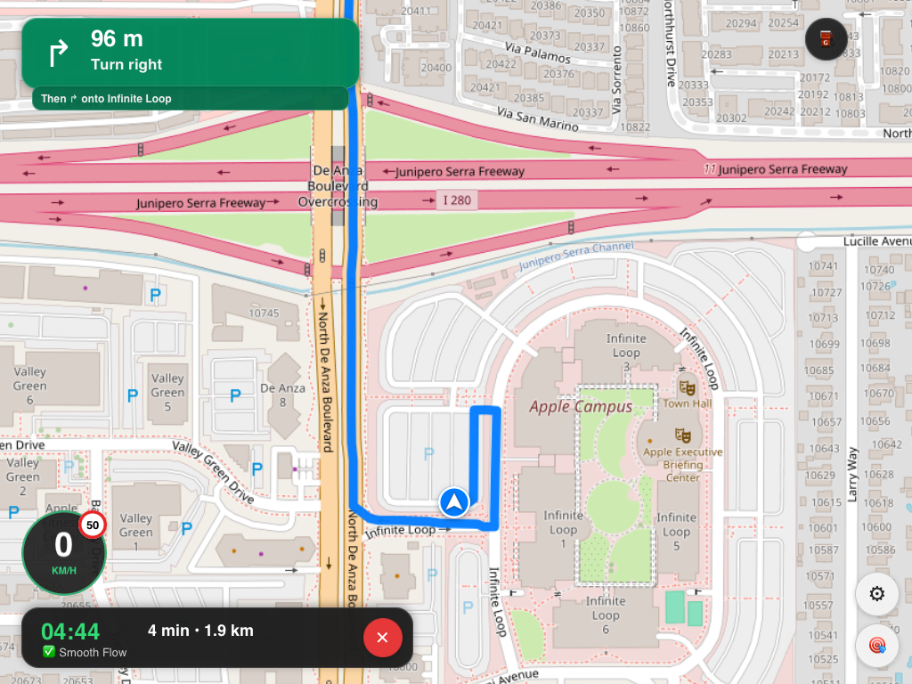
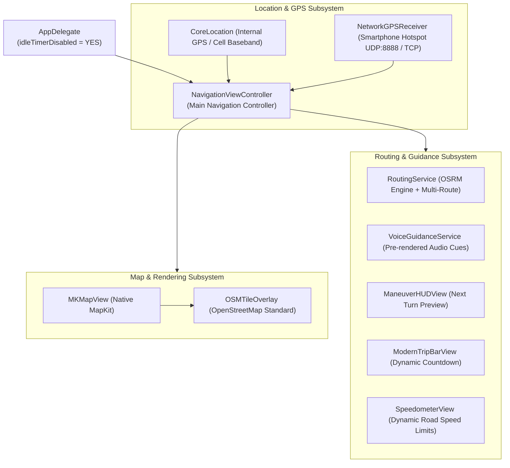

# 🗺️ NavigatorOSM: In-Car GPS Navigator for Legacy Devices (iOS 6.0 – 6.1.6 / 32-bit armv7)

[](https://github.com/noname122021/NavigatorOSM/releases)
[](https://github.com/noname122021/NavigatorOSM)
[](https://openstreetmap.org)
[](LICENSE)

> **Don't let your obsolete iPad become electronic waste.**  
> **NavigatorOSM (iOS 6 Edition)** backports the open-source GPS navigator created by [Nicola](https://github.com/vibe-maribit/NavigatorOSM) to legacy devices running **iOS 6.0 – 6.1.6** (iPad mini 1, iPad 2, iPad 3, iPad 4, iPhone 4/4S/5), repurposing them into dedicated in-car GPS navigators inspired by **Google Maps & Waze**.

---

## 📸 Real iPad Mini 1 Screenshot (iOS 6.1.2)

<p align="center">
  
</p>

---

## 💡 The Project Mission: Smart iPad Retrofitting

Millions of legacy Apple tablets—especially the **iPad Mini 1st Gen (A1432 / MD528TY/A)** with the **Apple A5 chip (dual-core 1.0 GHz Cortex-A9, 512 MB RAM)**—are currently sitting unused in drawers because modern iOS apps (Google Maps, Waze, Apple Maps) no longer support legacy iOS versions, and modern web maps crash due to RAM exhaustion.

**NavigatorOSM solves this with a 100% Pure Native Objective-C Architecture:**
- **Pure Native MapKit**: Runs natively without WebKit or embedded web browsers, avoiding JavaScript memory exhaustion and browser crashes.
- **Hardware-Accelerated Rendering**: Leverages the PowerVR GPU directly through MapKit and OpenGL ES pipelines for responsive zooming and panning.
- **Offline Maps & Area Downloader**: Download selected regions (zoom levels 13–16) directly to disk cache with asynchronous, non-blocking cache management and a controllable Stop button.
- **Zero API Keys Required**: Seamlessly runs on open community infrastructure (OpenStreetMap standard raster tiles and OSRM routing). Optional TomTom layer for live traffic flow.
- **Wi-Fi-Only iPad GPS Support**: Includes a companion Android app and UDP/TCP network GPS receiver to broadcast high-accuracy satellite coordinates from any smartphone hotspot.

---

## ✨ Key Features

| Feature | Description |
| :--- | :--- |
| 🏎️ **Navigation Cockpit** | Top-down map with vehicle tracking, two-finger rotation, dynamic speed-based altitude zoom, and North-up / Heading-up toggle. |
| 🎯 **Dead Reckoning & Map-Matching** | Continuous display loop interpolating GPS speed as a progress gradient along the road polyline without jerking sideways on noisy GPS readings. |
| 🛣️ **OSRM Multi-Route Corridors** | Calculates alternative routes on the fly with delta badges (`⭐ Optimal`, `🚀 Fastest`, `🍃 Alternative`) and relative time/distance estimates. |
| 🚦 **Dynamic Road Speed Limits** | Real-time road type classification based on highway tags with circular speedometer badge and visual overspeed alert. |
| 🗣️ **Discrete Voice Guidance** | Natural turn-by-turn audio prompts using distance checkpoints ($1000\text{m}$, $500\text{m}$, $200\text{m}$, *Now*) spoken strictly once per maneuver. |
| 🔄 **True Off-Route Recalculation** | Measures exact perpendicular distance to the route polyline. Veering $>65\text{m}$ off-track while moving triggers automatic route recalculation. |
| 📊 **Real-Time Trip Countdown** | `ModernTripBarView` dynamically counts down remaining distance, estimated travel time, and traffic status. |
| 🕒 **Recent Destinations History** | Stores recent searches and locations with 1-tap navigation initiation and history clearance. |
| ⛽ **Quick POI Shelf & Custom Search** | Viewport-bounded search for Gas Stations (`⛽`), Parking (`🅿️`), Coffee/Food (`☕`), and Restaurants (`🍴`) with interactive map pins and distance cards. |
| 📱 **Android GPS Tether Companion** | Broadcasts smartphone GPS coordinates over Wi-Fi hotspot to Wi-Fi-only iPads via UDP broadcast (`:8888`) or TCP client. |
| 📲 **Cydia OTA Wireless Updates** | Official Cydia repository for 1-tap wireless installations and updates over Wi-Fi. |
| 📋 **Route Selection & Summary** | Route selection cards with ETA, distance, and alternative route suggestions. |
| 🌐 **Multi-Language (EN / RU / UK / IT)** | Full multilingual support (English, Russian, Ukrainian, and Italian) with automatic system detection. |
| 🔌 **Always-On Driving Display** | `UIApplication.idleTimerDisabled = YES` prevents the screen from sleeping while driving. |

---

## 📱 Architecture & Subsystems



---

## 🚀 Installation Guide

### Method A: Wireless Over-The-Air via Cydia (Recommended)
1. Ensure your device is jailbroken on iOS 6.0 – 6.1.6 (evasi0n, p0sixspwn, CoolBooter).
2. Open **Cydia** on the device.
3. Tap **Sources** > **Edit** > **Add**.
4. Enter the repository URL:
   ```text
   https://noname122021.github.io/cydia-repo/
   ```
5. Tap **Add Source**.
6. Search for **NavigatorOSM** and tap **Install**.

### Method B: Companion Android GPS Tether App
For Wi-Fi-only iPads lacking internal GPS hardware:
1. Grab `GPSTether.apk` from `android/` or releases.
2. Install it on your Android smartphone.
3. Turn on Wi-Fi Hotspot on your phone and connect the iPad to it.
4. Launch **GPS Tether** on Android and tap **Start Tethering**.
5. Open **NavigatorOSM** on the iPad: the speedometer and map will immediately lock onto your smartphone's satellite fix.

---

## 🛠️ Building from Source

Requires macOS with [Theos](https://theos.dev) and `iPhoneOS6.1.sdk`:

```bash
make clean package FINALPACKAGE=1
```

---

## 🤝 Credits & Acknowledgments

- **Nicola** (`vibe-maribit`) — Original creator of [NavigatorOSM](https://github.com/vibe-maribit/NavigatorOSM) for iOS 9.
- **iOS 6 Revival Project** (`noname122021`) — Backport to iOS 6.0 – 6.1.6, legacy MapKit adaptation, asynchronous cache optimization, and maintenance.
- **OpenStreetMap** contributors — Map and POI data.
- **Project OSRM** — Routing engine.

---

## ⚖️ License

This project is licensed under the [MIT License](LICENSE).
